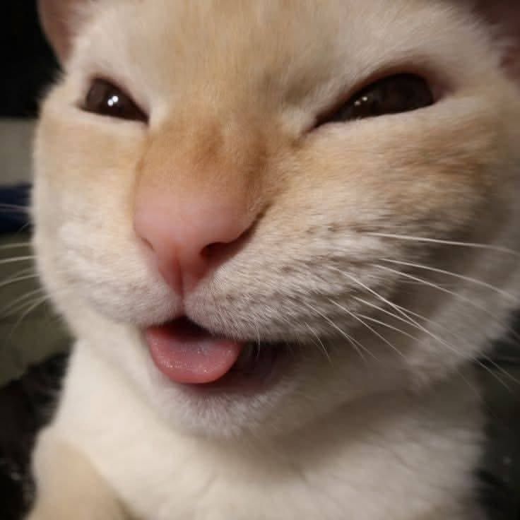

<!-- ══════════════════════ HEADER ══════════════════════ -->
<h1 align="center">hey, i'm rauf 👋</h1>

<p align="center"><i>i build AI things. the cat supervises.</i></p>

<p align="center">
  
</p>

<p align="center"><sub>senior code reviewer · has never approved a PR</sub></p>

<!-- ══════════════════════ SOCIAL BADGES ══════════════════════ -->
<p align="center">
  <a href="https://raufsarwer.vercel.app/"></a>
  <a href="https://www.linkedin.com/in/muhammad-rauf-sarwer-0a5977332"></a>
  <a href="mailto:raufsarwer00@gmail.com"></a>
  
</p>

<br />

<!-- ══════════════════════ ABOUT ME ══════════════════════ -->
### 🧑‍💻 &nbsp;About Me

```python
class RaufSarwer:
    role       = "ML & AI Engineer"
    education  = "M.S. Software Engineering"
    experience = "3+ years, hands-on"
    location   = "Pakistan 🇵🇰"

    building  = ["multimodal RAG", "multi-agent research", "production Python services"]
    deep_into = ["GenAI", "prompt engineering", "vector databases", "applied ML"]

    def philosophy(self) -> str:
        return "Ship reliable AI, not demos. (pending cat approval)"
```


<!-- ══════════════════════ TECH STACK ══════════════════════ -->
### 🛠️ &nbsp;Tech Stack

<div align="center">

**Languages**


**ML / AI &amp; GenAI**


**Backend, Data &amp; Tooling**


</div>


<!-- ══════════════════════ FEATURED PROJECTS ══════════════════════ -->
### 🚀 &nbsp;Featured Projects

<table>
<tr>
<td width="50%" valign="top">

#### 🕸️ [DeepGraph Research](https://github.com/groot654/deepgraph-research)
Multi-agent deep-research workflow. Five agents plan the research, search the web, score source
reliability, filter duplicates, and write a fully cited report.

`LangGraph` `Multi-Agent` `Python` `Web Search`

</td>
<td width="50%" valign="top">

#### 🖼️ [Multimodal RAG](https://github.com/groot654/multimodal-rag)
Semantic search over text, tables **and** images in one vector space — with structure-aware chunking
and per-modality relevance thresholds.

`Chroma` `Gemini Embeddings` `Groq / Llama 3.3` `LangChain` `Streamlit`

</td>
</tr>
<tr>
<td width="50%" valign="top">

#### 📄 [RAG Research Paper](https://github.com/groot654/RAG-Research-Paper)
Full-stack RAG app — upload research papers, ask questions, get grounded answers with citations.

`Gemini AI` `LangChain` `FAISS` `FastAPI` `React`

</td>
<td width="50%" valign="top">

#### 🧪 [LLM Playground](https://github.com/groot654/llm-playground)
A sandbox of experiments and demos with large language models and prompting patterns.

`LLMs` `Prompt Engineering` `HTML`

</td>
</tr>
</table>


<!-- ══════════════════════ CONTRIBUTION ACTIVITY ══════════════════════ -->
### 📈 &nbsp;Contribution Activity

<div align="center">


</div>

<!-- ══════════════════════ CONTRIBUTION SNAKE ══════════════════════ -->
### 🐍 &nbsp;Contribution Snake

<div align="center">
  <picture>
    <source media="(prefers-color-scheme: dark)" srcset="https://raw.githubusercontent.com/groot654/groot654/output/github-snake-dark.svg" />
    <source media="(prefers-color-scheme: light)" srcset="https://raw.githubusercontent.com/groot654/groot654/output/github-snake.svg" />
    
  </picture>
</div>


<!-- ══════════════════════ FOOTER ══════════════════════ -->
<p align="center">
  
</p>

<p align="center">
  <a href="mailto:raufsarwer00@gmail.com"></a>
</p>
